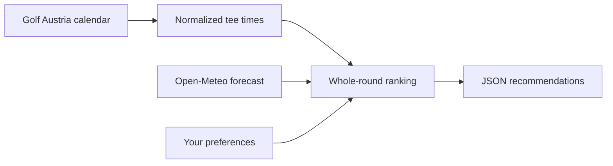

# Golf Austria Planner

[](https://github.com/JonasLaux/golf-austria-planner/actions/workflows/tests.yml)
[](LICENSE)

**Read Golf Austria tee-time data locally for agents.**

A local Python CLI that exposes the observed Golf Austria pages as structured
JSON. Direct mode reads a mapped provider calendar without hosting a service or
opening a browser. Optional planner commands still combine availability with
hourly weather and daylight; an agent can also pass the raw tee-sheet data to
its own calendar and weather services.

- Read available tee times, player spots, hole counts, and displayed prices.
- Keep every observed tee-time row, including empty, partly booked, and full rows.
- Expose anonymous player counts, products, prices, and course notices in JSON.
- Preserve partial and unavailable results so agents can decide what to do next.

This is an **unofficial integration** using Golf Austria's website and
Open-Meteo. It does not use an official booking API or submit reservations.

The repository also includes an agent skill at
[`skills/golf-austria/SKILL.md`](skills/golf-austria/SKILL.md). It describes the
thin JSON interface and the safety boundaries; the calling agent decides how to
combine tee times with weather, calendars, travel, or other services.

## Quick start

Requires Python 3.12+, Linux, and network access for direct reads. No server,
Chromium, or Golf Austria login is needed for the bundled direct mapping.

```bash
git clone https://github.com/JonasLaux/golf-austria-planner.git
cd golf-austria-planner
uv venv .venv
uv pip install --python .venv/bin/python -e .
.venv/bin/golf --help
```

Without `uv`, use `python3 -m venv .venv` followed by
`.venv/bin/python -m pip install -e .`. Replace `YYYY-MM-DD` with a date inside
the provider's booking window:

```bash
.venv/bin/golf clubs Leopoldsdorf
.venv/bin/golf times --direct --club 318 --date YYYY-MM-DD
```

The `golf` executable can be called from `PATH`; the examples use
`.venv/bin/golf` from the repository checkout. Dates use `Europe/Vienna`.

| Command | Purpose | Browser/login |
| --- | --- | --- |
| `clubs SEARCH_TERM` | Search the public club directory | Neither |
| `times --direct --club ID --date YYYY-MM-DD` | Read a verified provider mapping | Neither |
| `login`, `status` | Sign in or check the dedicated session | Dedicated browser |
| `times --club ID --date YYYY-MM-DD` | Read through the authenticated calendar | Dedicated browser |
| `open --club ID --date YYYY-MM-DD` | Hand the calendar to the user for booking | Dedicated browser |

**Current coverage:** direct reads are verified for Leopoldsdorf (`318`). The
directory search is capped, so it is not a complete list of Austrian clubs.
Scorecards, reservation history, booking, and cancellation are not implemented.

`times --direct` calls the observed Golf Austria provider calendar directly and
does not read the browser profile or require a login. It needs a configured
provider issuer and a nonempty verified course-name mapping; the bundled direct
mapping is Leopoldsdorf (`318`). The provider query defaults to `--hour 6
--minute 0`, and accepts explicit values. The JSON includes the upstream query,
`transport: "direct_http"`, `authentication: "public"`, all observed `slots`,
and the existing free-seat `candidates`. Direct mode is a read-only upstream
call; it never follows checkout links or submits a booking.

The `slots` array preserves every observed tee-time row, including full and
partly booked rows, with anonymous occupancy counts. It is intentionally raw
enough for an agent to apply request-specific rules such as a time window,
joining an existing group, or a configurable buffer around a slot. Joining an
existing group includes both empty and partly booked rows when the user allows
it. Unknown occupancy stays unknown; no quiet-time or buffer preference is
hardcoded.

When multiple product offerings make a row's physical free-space count
ambiguous, `slots.available_players` is `null` and `occupancy_known` is false.
Use each candidate's availability for its particular offering.

Exit codes are `0` for a completed query, `1` for validation or command errors,
and `2` for partial, unavailable, or unmapped results. Exit `2` does not mean
that no tee time exists; inspect the JSON `status` and messages. Invalid command
syntax also exits `2`, with usage text on stderr instead of a JSON result.

## Agent skill

Load [`skills/golf-austria/SKILL.md`](skills/golf-austria/SKILL.md) from this
checkout when an agent needs the command contract and safety boundaries. The
skill is portable and is not installed globally by this repository. If an agent
expects skills in a separate directory, copy or symlink this folder there using
that agent's normal skill-install mechanism.

## Optional browser and planner commands

The browser path remains available for authenticated inspection and manual
booking handoff. Login and manual booking need a graphical desktop; subsequent
lookups run headlessly. Install Chromium only for these commands:

```bash
.venv/bin/python -m playwright install chromium
.venv/bin/golf login
.venv/bin/golf status
.venv/bin/golf times --club 318 --date YYYY-MM-DD
.venv/bin/golf open --club 318 --date YYYY-MM-DD
```

Sign in directly in the dedicated browser window. The CLI saves your session
outside the repository; run `login` again when it expires. An installed
`chromium` or `google-chrome` is used when available, with Playwright's download
as the fallback. Set `GOLF_BROWSER=/absolute/path/to/chromium` to override it.
Use `open` only after choosing a fresh slot; it does not submit or verify a
reservation.

The existing `recommend`, `weather`, and `rank` commands remain optional
planner utilities. They can combine tee times with weather and player
preferences, but the direct tee-sheet path does not impose those filters.

Recommendations default to **9 holes, one player, and 120 minutes**. For 18 holes,
the estimated duration is 270 minutes. Override it with `--duration`: a realistic
finish time matters for both weather and daylight. Selecting 18 holes filters
18-hole offerings; it does not combine two 9-hole reservations.

## Results you can inspect

Tee-time reads return JSON with anonymous slots, available products, displayed
prices, and notices. Optional recommendation commands add scores, exclusions,
uncertainties, and per-club outcomes. Failed queries are identified explicitly;
partial results can still contain useful candidates.

The following abbreviated direct-read output is **synthetic**. It contains
no live tee times or account data:

```json
{
  "status": "ok",
  "club": "Example Golf Club",
  "transport": "direct_http",
  "authentication": "public",
  "verified_at": "2030-06-10T07:00:00+00:00",
  "slots": [{
    "start": "2030-06-10T10:00:00+02:00",
    "available_players": 2,
    "booked_players": 2,
    "unknown_players": 0,
    "occupancy_known": true
  }],
  "candidates": [{
    "club": "Example Golf Club",
    "start": "2030-06-10T10:00:00+02:00",
    "holes": 9,
    "available_players": 2,
    "price_eur": 35,
    "currency": "EUR"
  }]
}
```

## Booking and club coverage

```bash
.venv/bin/golf open --club 318 --date YYYY-MM-DD
```

This opens the authenticated calendar. Select your time, review the current price
and terms, and complete the booking yourself. The CLI reports
`booking_status: not_verified`; it does not inspect reservation history or claim
success. Lookup commands do not follow checkout links, which can initialize a
basket even without submitting a form.

[Bundled club metadata](golf_austria/data/clubs.json) includes Leopoldsdorf (`318`)
and Wienerberg (`902`) as public examples, with coordinate sources. Pass
`--clubs-file /path/clubs.json` to `times`, `recommend`, or `open` for another
configuration. Use `clubs SEARCH_TERM` to find Golf Austria club IDs.

The adapter supports the observed `teetimes.golf.at` calendar. Direct reads need
a verified issuer and course-name mapping; browser access can depend on your
account and the club. Other providers and unrecognized pages produce explicit
errors. Site markup can change, and adding club metadata alone does not establish
booking-system support. Final member pricing and rules still need checking in
the calendar.

See the [endpoint map](docs/golf-austria-endpoints.md) for verified upstream
requests, direct-mode behavior, search limits, and the remaining provider
coverage questions.

## How recommendations work



Calculations use UTC to handle daylight-saving changes. Rain and gust values
describe the preceding hour; every overlapping hour is included, with partial
hours counted whole. Reported rain probability is the highest hourly value,
**not** the probability of rain at any point in the round.

The 0–100 score is a preference heuristic, with bounded penalties for rainfall,
rain probability, wind, gusts, and uncomfortable feels-like temperatures. Explicit
limits take priority. Thunderstorms, frozen precipitation, confirmed closures,
insufficient player spots, and rounds outside daylight are excluded. The default
sunset margin is 30 minutes. Missing information, unresolved rules, availability
over 15 minutes old, or forecasts fetched over six hours ago block eligibility.

Course notices remain warnings: a conditional frost rule is not proof of frost,
and a range closure is not a course closure. `eligible` means the supplied data
meets known constraints; ranked results keep `bookable` false. Raw tee-time
results have no `bookable` field. The tool does not evaluate travel time, calendar
conflicts, live ground conditions, or cancellation terms.

For standalone weather queries or imported candidates:

```bash
.venv/bin/golf weather --latitude 48.10 --longitude 16.40
.venv/bin/golf rank examples/candidates.json --max-price 60
.venv/bin/golf rank /path/candidates.json --forecasts /path/forecasts.json \
  --preferences /path/preferences.json
```

The included candidate file is synthetic and never eligible. Saved forecasts
are keyed by club name and retain their original `fetched_at` timestamp.

## Session privacy and development

Direct mode does not read or create private browser state. Optional browser
state stays outside the repository, in `$XDG_STATE_HOME/golf-austria` or
`~/.local/state/golf-austria` when unset. Set `GOLF_STATE_DIR` or override it with
`golf --state-dir /private/path COMMAND`. The dedicated profile does not read
your everyday browser, and only one command can use it at a time.

**Saved cookies are plaintext credentials**, protected by owner-only directory
permissions and mode `0600` for the cookie snapshot; they are not encrypted.
Do not commit or share browser profiles, cookies, raw account pages, or personal
reports. Keep issues and test fixtures synthetic and free of player information.

```bash
.venv/bin/python -m unittest discover -s tests -v
```

Tests use synthetic fixtures and mocked responses. See [AGENTS.md](AGENTS.md) for
development commands and [SECURITY.md](SECURITY.md) for sensitive-data handling
and vulnerability reports. This project is [MIT licensed](LICENSE).

Sources: [Golf Austria](https://www.golf.at/golf-austria-app),
[MyGolf login](https://www.golf.at/mygolf/login), and
[Open-Meteo API documentation](https://open-meteo.com/en/docs).
Weather attribution: [Open-Meteo](https://open-meteo.com/), CC BY 4.0.
