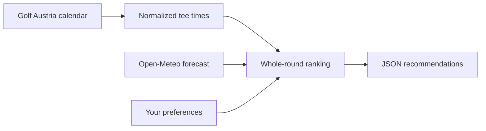

# Golf Austria Planner

[](https://github.com/JonasLaux/golf-austria-planner/actions/workflows/tests.yml)
[](LICENSE)

**Find a tee time with good weather for the whole round.**

A local Python CLI that combines Golf Austria availability with hourly weather,
daylight, and your playing preferences. Compare options across clubs, see why a
slot fits or fails, then open the calendar to book it yourself.

- Read available tee times, player spots, hole counts, and displayed prices.
- Compare rain, temperature, wind, and gusts from tee-off through the finish.
- Filter by time window, budget, player count, and weather limits.
- Keep course notices and incomplete queries visible in structured JSON.

This is an **unofficial integration** using Golf Austria's website and
Open-Meteo. It does not use an official booking API or submit reservations.

## Quick start

Requires Python 3.12+, Linux, network access, and Chromium. Login and manual
booking need a graphical desktop; subsequent lookups run headlessly.

```bash
git clone https://github.com/JonasLaux/golf-austria-planner.git
cd golf-austria-planner
uv venv .venv
uv pip install --python .venv/bin/python -e .
.venv/bin/python -m playwright install chromium
.venv/bin/golf login
```

Without `uv`, use `python3 -m venv .venv` followed by
`.venv/bin/python -m pip install -e .`. An installed `chromium` or `google-chrome`
is used when available; the Playwright download is the fallback. Set
`GOLF_BROWSER=/absolute/path/to/chromium` to choose another executable.

Sign in directly in the dedicated browser window. The CLI saves your session
after recognizing the authenticated page. Run `golf login` again if it expires;
the examples below use the full `.venv/bin/golf` path without shell activation.

Replace `YYYY-MM-DD` with a future date inside your club's booking window:

```bash
.venv/bin/golf status
.venv/bin/golf clubs Leopoldsdorf
.venv/bin/golf times --club 318 --date YYYY-MM-DD
.venv/bin/golf recommend --club 318 --date YYYY-MM-DD \
  --holes 9 --players 1 --after 09:00 --before 13:00 \
  --max-price 35 --max-rain 30 --max-wind 20 --max-gust 35
```

Omit `--club` to compare all configured clubs, or repeat it to select several.
Use `--limit` to change the number of results and `--min-temperature 8` to require
at least 8°C throughout play. Dates and time filters use `Europe/Vienna`; prices
are **EUR per player**, wind speeds are **km/h**, and rain limits are percentages.

Recommendations default to **9 holes, one player, and 120 minutes**. For 18 holes,
the estimated duration is 270 minutes. Override it with `--duration`: a realistic
finish time matters for both weather and daylight. Selecting 18 holes filters
18-hole offerings; it does not combine two 9-hole reservations.

## Results you can inspect

Commands return JSON with scores, exclusions, uncertainties, notices, and
per-club outcomes. Failed queries are identified explicitly; partial results
can still contain useful candidates.

The following abbreviated terminal output is **synthetic**. It illustrates
the output shape; it contains no live tee times or account data:

```json
{
  "candidates": [{
      "club": "Example Golf Club",
      "holes": 9,
      "score": 89,
      "eligible": false,
      "bookable": false,
      "status": "excluded",
      "reasons": ["Synthetic example; this is not a real tee time."],
      "weather": {"rain_probability_max_pct": 10, "wind_max_kmh": 8}
  }]
}
```

Exit codes are `0` for normal completion, `1` for command errors, and `2` for
partial or unavailable results. Normal completion does not guarantee a suitable
slot; check each candidate's `eligible`, `reasons`, and `uncertainties` fields.

## Booking and club coverage

```bash
.venv/bin/golf open --club 318 --date YYYY-MM-DD
```

This opens the authenticated calendar. Select your time, review the current price
and terms, and complete the booking yourself. The CLI reports
`booking_status: not_verified`; it does not inspect reservation history or claim
success. Lookup commands do not follow checkout links, which can initialize a
basket even without submitting a form.

[Bundled club metadata](golf_austria/data/clubs.json) includes Leopoldsdorf (`318`)
and Wienerberg (`902`) as public examples, with coordinate sources. Pass
`--clubs-file /path/clubs.json` to `times`, `recommend`, or `open` for another
configuration. Use `clubs SEARCH_TERM` to find Golf Austria club IDs.

The adapter supports the observed `teetimes.golf.at` calendar. Access depends on
your account and the club; other providers and unrecognized pages produce
explicit errors. Site markup can change, and adding a club does not establish
that its booking system is supported. Final member pricing and rules still need
checking in the calendar.

## How recommendations work



Calculations use UTC to handle daylight-saving changes. Rain and gust values
describe the preceding hour; every overlapping hour is included, with partial
hours counted whole. Reported rain probability is the highest hourly value,
**not** the probability of rain at any point in the round.

The 0–100 score is a preference heuristic, with bounded penalties for rainfall,
rain probability, wind, gusts, and uncomfortable feels-like temperatures. Explicit
limits take priority. Thunderstorms, frozen precipitation, confirmed closures,
insufficient player spots, and rounds outside daylight are excluded. The default
sunset margin is 30 minutes. Missing information, unresolved rules, availability
over 15 minutes old, or forecasts fetched over six hours ago block eligibility.

Course notices remain warnings: a conditional frost rule is not proof of frost,
and a range closure is not a course closure. `eligible` means the supplied data
meets known constraints; `bookable` is always false. The tool does not evaluate
travel time, calendar conflicts, live ground conditions, or cancellation terms.

For standalone weather queries or imported candidates:

```bash
.venv/bin/golf weather --latitude 48.10 --longitude 16.40
.venv/bin/golf rank examples/candidates.json --max-price 60
.venv/bin/golf rank /path/candidates.json --forecasts /path/forecasts.json \
  --preferences /path/preferences.json
```

The included candidate file is synthetic and never eligible. Saved forecasts
are keyed by club name and retain their original `fetched_at` timestamp.

## Session privacy and development

Browser state stays outside the repository, in `$XDG_STATE_HOME/golf-austria` or
`~/.local/state/golf-austria` when unset. Set `GOLF_STATE_DIR` or override it with
`golf --state-dir /private/path COMMAND`. The dedicated profile does not read
your everyday browser, and only one command can use it at a time.

**Saved cookies are plaintext credentials**, protected by owner-only directory
permissions and mode `0600` for the cookie snapshot; they are not encrypted.
Do not commit or share browser profiles, cookies, raw account pages, or personal
reports. Keep issues and test fixtures synthetic and free of player information.

```bash
.venv/bin/python -m unittest discover -s tests -v
```

Tests use synthetic fixtures and mocked responses. See [AGENTS.md](AGENTS.md) for
development commands and [SECURITY.md](SECURITY.md) for sensitive-data handling
and vulnerability reports. This project is [MIT licensed](LICENSE).

Sources: [Golf Austria](https://www.golf.at/golf-austria-app),
[MyGolf login](https://www.golf.at/mygolf/login), and
[Open-Meteo API documentation](https://open-meteo.com/en/docs).
Weather attribution: [Open-Meteo](https://open-meteo.com/), CC BY 4.0.
